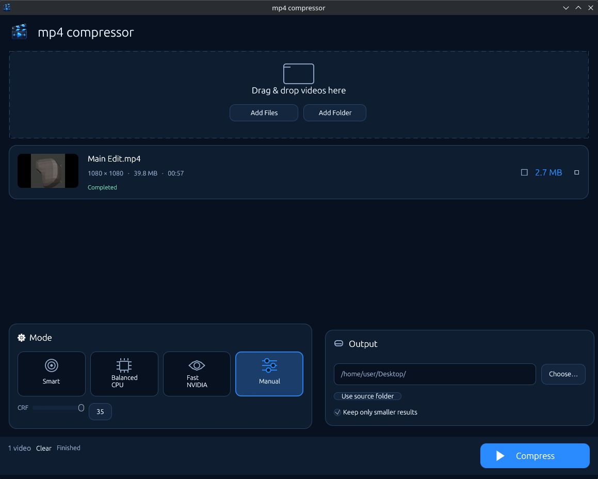

# mp4 compressor — v0.5 target-reduction engine



**Arch Linux / KDE Plasma / Wayland. One native Rust GUI, no JS, WebView, Node, server or cloud.**
Actual compression is performed by installed `ffmpeg` and `ffprobe` executables (not bundled).

## Start

Download the Linux release archive, extract it, and run the executable:

```bash
tar -xzf mp4-compressor-linux-x86_64.tar.gz
./mp4-compressor-linux-x86_64
```

If you download the standalone executable instead of the archive, Linux does
not preserve its executable bit. Run `chmod +x mp4-compressor-linux-x86_64`
once before starting it. The program also needs system `ffmpeg` and `ffprobe`.
On Plasma Wayland, it uses XWayland, so `xorg-xwayland` must be installed and
`$DISPLAY` must be set. Run `./mp4-compressor-linux-x86_64 --check` to inspect
FFmpeg support. If the GUI closes immediately, run it in a terminal and keep
the error output.

To build from source instead:

```bash
sudo pacman -S --needed rustup base-devel pkgconf ffmpeg xdg-desktop-portal-kde xdg-utils
rustup default stable
./scripts/verify.sh
./target/release/mp4-compressor
```

For a display-free smoke test after compilation:

```bash
./target/release/mp4-compressor --check
./scripts/smoke.sh
./target/release/mp4-compressor --headless --mode balanced 'video.mp4'
```

## Target reduction

Set a requested file-size reduction from **0% to 95%** with the slider or its adjacent editable number field (default **80%**). A 200 MB source at 90% requests about 20 MB output. This is a **bitrate goal**, not a size cap or a guarantee of visual quality. Already efficient sources may become larger, while aggressive targets may introduce artifacts. The program does not silently change the source resolution, frame rate, or H.264 codec.

- **Precise CPU** (`--mode auto`): `libx264 -preset medium`, **two-pass average bitrate**. Predictable sizes and efficient bit distribution, at the cost of two encode passes.
- **Quick CPU** (`--mode balanced`, default): `libx264 -preset medium`, **single-pass average bitrate**. Faster, but output-size accuracy is lower.
- **Fast NVIDIA** (`--mode fast`): NVENC `p3` VBR at the calculated target bitrate. Tries CUDA decoding for compatible files and retries CPU decode if necessary. If the NVENC probe fails, explicitly falls back to Quick CPU. Output size is approximate.
- **Manual CPU** (`--mode manual`): quality-driven x264 CRF encoding; this advanced mode deliberately ignores the percentage target.

Video bitrate is calculated from duration, source bytes, estimated audio bitrate and MP4 overhead. A minimum video bitrate floor allows exceeding unrealistic targets. Compatible AAC-LC tracks are copied; other audio is encoded as AAC 128 kbps. Final output is verified for codec, dimensions, timing and decodability. The job's completed-state tooltip records which path actually ran and how long it took.

```bash
./target/release/mp4-compressor --headless --mode auto --reduction 90 'video.mp4'
./target/release/mp4-compressor --headless --mode fast --reduction 80 'video.mp4'
```

Default social-compatible output: MP4, H.264 High, 8-bit yuv420p, AAC or compatible AAC-LC stream copy, faststart. Input files are never overwritten. Failed/cancelled outputs are not published; larger outputs are kept by default unless **Skip files larger than the source** is selected.

### Important boundaries

- **Not guaranteed lossless or 80–90% smaller.** The percentage controls a bitrate budget, not a guaranteed perceptual quality floor. Inspect text, edges, noise and motion after aggressive compression.
- HDR/PQ/HLG, 10/12-bit and nonzero display rotation are rejected to protect footage. No AV1 encoder, no cloud.
- Only the first audio track is kept. Subtitle and data tracks are dropped intentionally for social uploads.
- For output on FAT/exFAT filesystems, safe no-replace publication uses create-new+copy rather than atomic hardlink. It removes failed copies, but cannot promise a completely atomic publication on these filesystems.
- Release binaries and CI logs are published under GitHub Actions Artifacts; `target/` is excluded from Git. Native KDE/Dolphin drag-and-drop still requires a local interactive check.

### Debugging / native build environment

```bash
cargo fmt --all
cargo check --all-targets
cargo clippy --all-targets -- -D warnings
cargo test
cargo build --release
```

If OpenGL initialization fails in KDE Wayland, test from an X11 session or via XWayland. An eframe `wgpu`-based renderer is a possible later fallback.

Source references: [eframe](https://github.com/emilk/egui), [rfd](https://github.com/PolyMeilex/rfd), [HandBrake bitrate guide](https://handbrake.fr/docs/en/latest/technical/video-cq-vs-abr.html), [NVIDIA FFmpeg guide](https://docs.nvidia.com/video-technologies/video-codec-sdk/13.1/ffmpeg-with-nvidia-gpu/), [FFmpeg](https://ffmpeg.org/). Rust source license: MIT; system FFmpeg licensing is separate (libx264-enabled FFmpeg builds may be GPL).

## Linux KDE Plasma and file drag-and-drop (v0.3)

This build uses the native **X11 backend** of `eframe` deliberately. On KDE
Plasma Wayland it runs via **XWayland** (`xorg-xwayland` package) so Dolphin
file drags reach egui. `winit 0.30`, used by `eframe 0.33`, does not deliver
file-drop events via its native Wayland backend. Do not claim native Wayland
drag-and-drop support. On Wayland make sure `$DISPLAY` is populated and the
`xorg-xwayland` package is installed. Drag from Dolphin into the window or use
`+ Add files` as a fallback. This is not tested interactively in headless CI.

## NVIDIA diagnostics

Fast NVIDIA now uses a 320×240 real encode to probe NVENC instead of 64×64
(which NVENC can reject). If unavailable it **explicitly** falls back to CPU
and exposes FFmpeg's diagnostic in the job message. For local diagnostics run
`./target/release/mp4-compressor --check`, `nvidia-smi`, and:

```bash
ffmpeg -hide_banner -f lavfi -i 'color=c=black:s=320x240:r=30' -frames:v 3 -c:v h264_nvenc -f null -
```

On Arch, ensure kernel driver and `nvidia-utils` versions match and check
`/usr/lib/libnvidia-encode.so.1`. Do not blindly overwrite working drivers.


## v0.4 desktop UI

The native egui interface now follows the premium dark mockup: centered drop zone,
real FFmpeg-generated asynchronous thumbnails, four large mode tiles, distinct
Mode and Output panels, and a persistent action footer. The designed clapperboard
icon is embedded into the application and X11 window icon. FFmpeg/ffprobe remain
external dependencies. Drag-and-drop uses X11/XWayland on KDE Plasma.

For a desktop launcher, copy `assets/mp4-compressor.desktop` to
`~/.local/share/applications/` and `assets/mp4-compressor-256.png` to
`~/.local/share/icons/hicolor/256x256/apps/mp4-compressor.png`; ensure the
`mp4-compressor` binary can be found on PATH.
